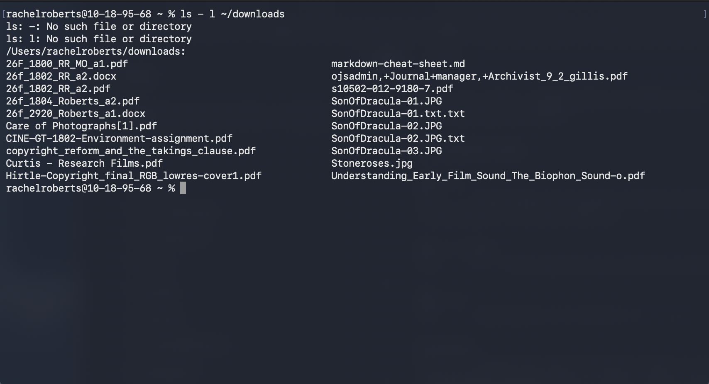

# The clear Command

## Summary 
The `clear` command removes all the visible text and outputs from your current terminal window, in other words, it clears your terminal. It looks in the environment for the terminal type and then in the termini database to determine how to clear the screen.

## Basic command structure
For all descriptions below, the dollar sign indicates that BASH command prompt.

$ `clear`

Note: the 'clear' command does not delete your command history, but it erases your scrollback history. It also ignores any command line that may be present. 

## Possible Flags

### `-x`
The `-x` flag clears the visible screen but does not clear the scrollback buffer. This allows you to keep your terminal history by scrolling up or pressing Page Up. 

### `-T type`
The `-T type` flag specifies the specific terminal type instead of using the environment variable. (`TERM` `LINES``COLUMNS`)

### `-V`
The  `V` flag reports the version of `ncurses` associated with the program being used by clear.

## Output
The `ls` command has many different kinds of outputs as described below:
* **Standard output** with no flags, which clears the visible text on the terminal screen:

* **Output with `-l` flag**, which displays directories and files in a list form with metadata in colums:

## Examples 
* If you want to see hidden files in a nice list format run $ `ls -la ~`. The `~` would indicate your home folder.
* To get a the contents of an entire directory structure starting at a parent folder: $ `ls -alRt`. If you'd like, you can use a redirect, such as `>` to send the output to a text file. Here's an example: $ `ls -alRt ~/Desktop > ~/Desktop/report.txt`

Go back to the [main list of commands](index.md)
