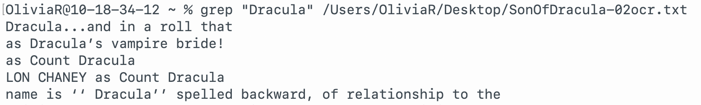
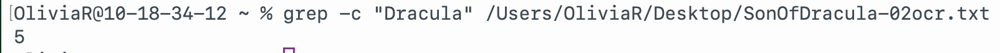

# The grep Command

## Summary 
The `grep` command searches any given input files, selecting lines that match one or more patterns.

It can search for specific words, phrases, or patterns inside a text file, and display the matching lines.

## Basic command structure
For all descriptions below, the dollar sign indicates that BASH command prompt.

$ `grep [options] pattern [file]`

## Possible Flags

### `-i`
Perform case insensitive matching.  By default, grep is case sensitive.

### `-c'
Displays the number of lines that match the given pattern.

### `-l'
Displays the files that contain the given pattern.

### `-v'
Displays the the lines that do **not** match the given pattern.

## Output
The `grep` command has many different kinds of outputs as described below:
* **Standard output** with no flags, which displays the lines containing the word, phrase, or pattern:

* **Output with `-c` flag**, which displays the number of lines containing the word, phrase, or pattern:

Go back to the [main list of commands](index.md)
