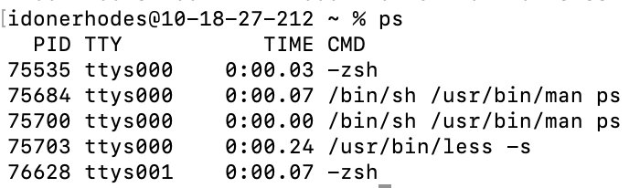
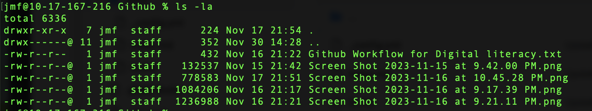

# The ps Command

## Summary 
`ps` is the command for process status. The ps utility displays a header line, followed by lines containing information about all of your processes that have controlling terminals.

## Basic command structure
For all descriptions below, the dollar sign indicates that BASH command prompt.

$`ps[option]`

Note: If you do not specify an option using a flag, running `ps` will show you the current processes in your terminal session.

## Possible Flags
It is possible to use multiple flags at a time. 

### `-m`
The `-m` flag sorts the output by memory usage, instead of the combination of controlling terminal and process ID.

### `-A`
The `-A` flag displays information about other users' processes, including those without controlling terminals.

### `-l`
The `-l` flag displays information associated with the following keywords: uid, pid, ppid, cpu, pri, nice, vsz, rss, wchan, state, tt, time and command.

## Output
The `ps` command has many different kinds of outputs as described below:
* **Standard output** with no flags, which displays the names of directories and files within the directory where the command is run:

* **Output with `-l` flag**, which displays directories and files in a list form with metadata in colums:

## Examples 
* If you want to see hidden files in a nice list format run $ `ls -la ~`. The `~` would indicate your home folder.
* To get a the contents of an entire directory structure starting at a parent folder: $ `ls -alRt`. If you'd like, you can use a redirect, such as `>` to send the output to a text file. Here's an example: $ `ls -alRt ~/Desktop > ~/Desktop/report.txt`

Go back to the [main list of commands](index.md)
