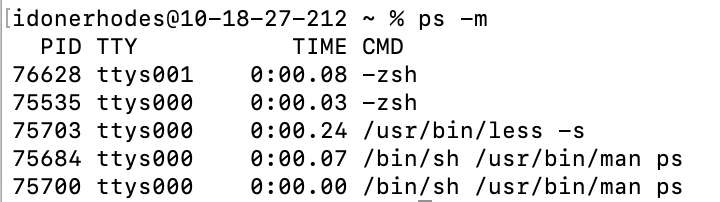

# The ps Command

## Summary 
`ps` is the command for process status. `ps` will return information about processes running on your computer.

## Basic command structure
For all descriptions below, the dollar sign indicates that BASH command prompt.

$`ps[option]`

Note: If you do not specify an option using a flag, running `ps` will show you the current processes in your terminal session.

## Possible Flags
It is possible to use multiple flags at a time. 

### `-m`
The `-m` flag sorts the output by memory usage, instead of the combination of controlling terminal and process ID.

### `-A`
The `-A` flag displays information about other users' processes, including those without controlling terminals.

### `-l`
The `-l` flag displays information associated with the following keywords: uid, pid, ppid, cpu, pri, nice, vsz, rss, wchan, state, tt, time and command.

## Output
The `ps` command has many different kinds of outputs as described below:
* **Standard output** with no flags, which displays processes running in your terminal.

* **Output with `-m` flag**, which displays processes sorted by memory usage.

## Examples 
* To get a comprehensive list of all processes currently running on your system, use `ps aux`.

Go back to the [main list of commands](index.md)
