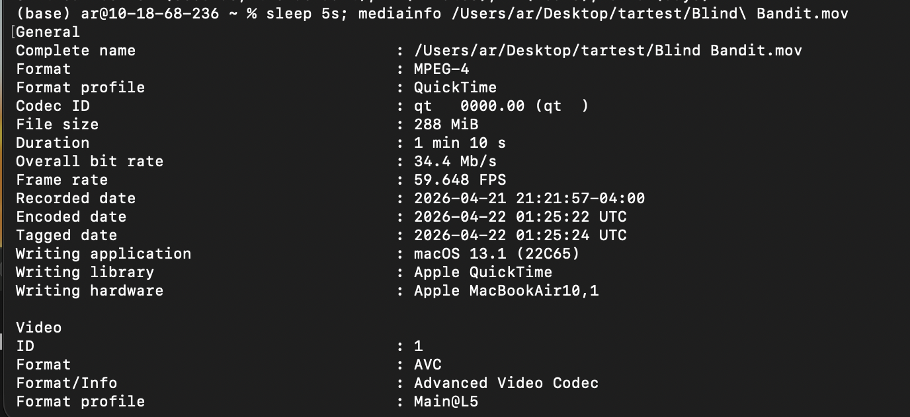

# The sleep Command

## Summary 
The 'sleep' command will pause the execution of a function in Terminal for a set amount of time. 

## Basic command structure 

sleep number[unit] [...]

Numbers can be expressed as positive integers and decimals. i.e. 5, 3, 427, 10.2. 

Units can be seconds, minutes, hours, or days. (s, m, h, d respectively) 

If you have multiple terms in your argument, they will be added together. Like so: 

## Output 

There won't be an exact output, but the terminal window will look as if it is loading. You will not be able to write any more commands while it is counting down. 

## Use case

Sleep can be useful if you want to delay a command being run by Terminal. The syntax will change slightly to do this: 

Go back to the [main list of commands](index.md)
